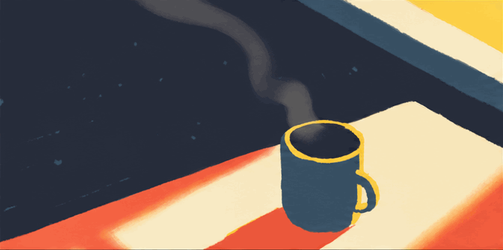
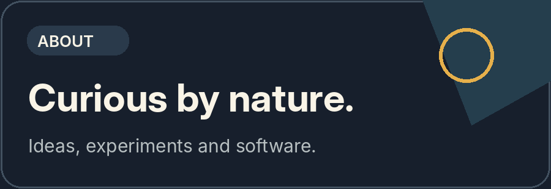
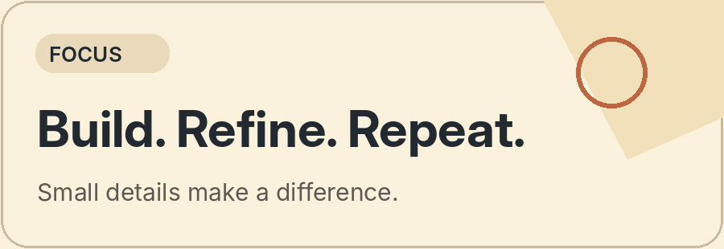

  

  <h1>Sinqanz</h1>

  
Building useful things, one idea at a time.

  
Independent projects &nbsp;·&nbsp; Software &nbsp;·&nbsp; Exploring what’s next

---

### About

I enjoy experimenting with software, exploring new ideas, and working on the details that make a product feel right. I prefer building things with a clear purpose and learning as I go.

### A closer look

  
  &nbsp;
  

### Currently

- Working on independent software projects.
- Exploring useful tools and better user experiences.
- Learning through testing, improving and shipping things.

### Explore

[Repositories ↗](https://github.com/sinqanz?tab=repositories) &nbsp; · &nbsp; [Contributions ↗](https://github.com/sinqanz?tab=overview) &nbsp; · &nbsp; [Profile ↗](https://github.com/sinqanz)

---

  Thoughtful ideas. Simple execution.

