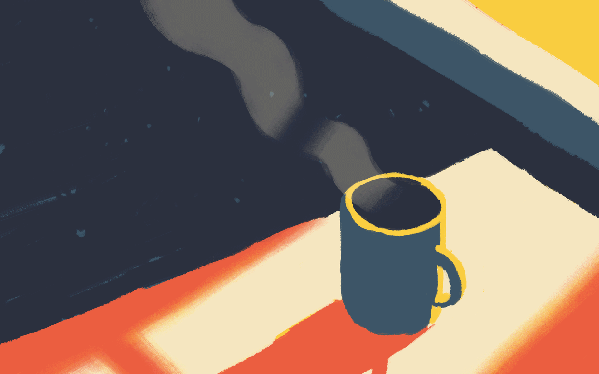
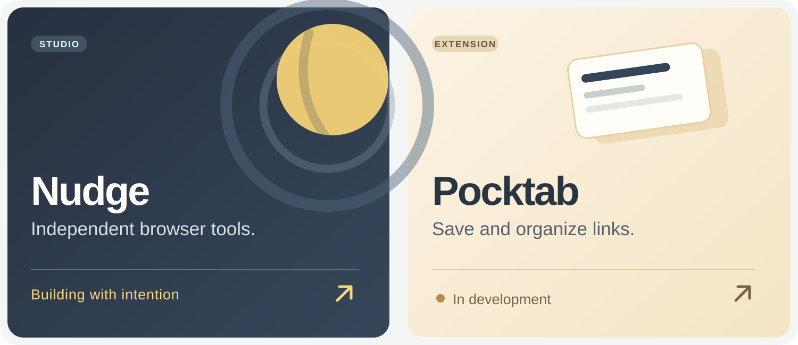
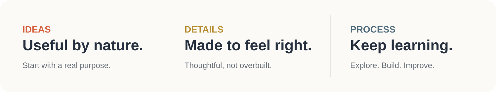

  

 

# Sinqanz

Building useful things, one idea at a time.

[**My GitHub**](https://github.com/sinqanz) &nbsp;·&nbsp; **Independent projects** &nbsp;·&nbsp; **Browser tools**

---

### About

I like exploring new ideas, experimenting with software and paying attention to the details that make a product feel right. I build at my own pace and share what I make along the way.

### Current work

Nudge is an independent project for thoughtful browser tools. Its first extension, **Pocktab**, is being developed to help save and organize links.

### How I approach things

### Explore

[**Repositories ↗**](https://github.com/sinqanz?tab=repositories) &nbsp;&nbsp;·&nbsp;&nbsp; [**Contributions ↗**](https://github.com/sinqanz?tab=overview) &nbsp;&nbsp;·&nbsp;&nbsp; [**Profile ↗**](https://github.com/sinqanz)

---

  Less noise. More room for good ideas.

