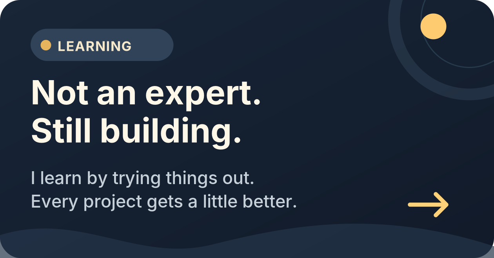
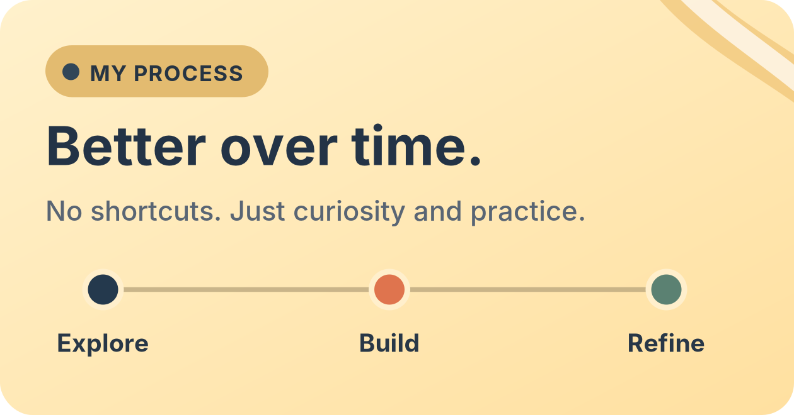

  

  <h1>Hey, I'm Sinqanz.</h1>
  
Exploring ideas, building small projects, and getting better as I go.

  

    <a href="https://github.com/sinqanz?tab=repositories">Repositories ↗</a>
    &nbsp; · &nbsp;
    <a href="https://github.com/sinqanz?tab=overview">Activity ↗</a>
  

---

### A little about me

I'm still learning my way around software development. I'm not an experienced developer yet, but I enjoy experimenting, working through challenges, and improving the details. Every project teaches me something new — and I want each one to be better than the last.

### A closer look

  
  &nbsp;
  

### What I'm exploring

- Independent software projects and useful everyday tools.
- Thoughtful interfaces and the little things that make them feel right.
- Learning by building, testing, making mistakes, and trying again.

  
<b>A note on my progress</b>

   
  I'm at the beginning of my developer journey. This profile is a place to share what I work on, track how much I improve, and look back at the projects that helped me learn.

 

  Explore. Build. Refine. Repeat.

