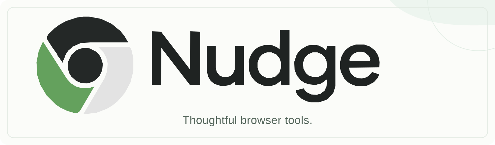

  

 

# Hey, I'm Sinqanz.

I'm interested in thoughtful software and the small details that make digital products feel better.

Currently building **Nudge**, an independent studio focused on useful browser extensions.

## What I'm working on

**Nudge Studio**  
A home for simple, carefully considered browser tools.

**Pocktab**  
An upcoming Chrome extension for saving and organizing links. Currently in development.

## GitHub activity

  
   
  

---

  Small tools. A calmer web.

